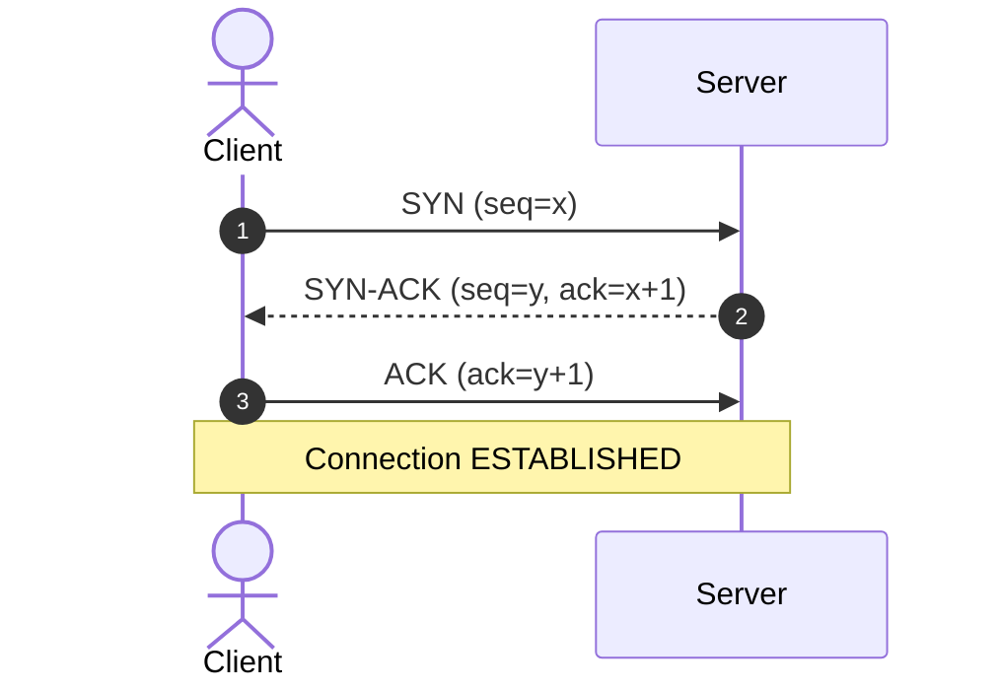
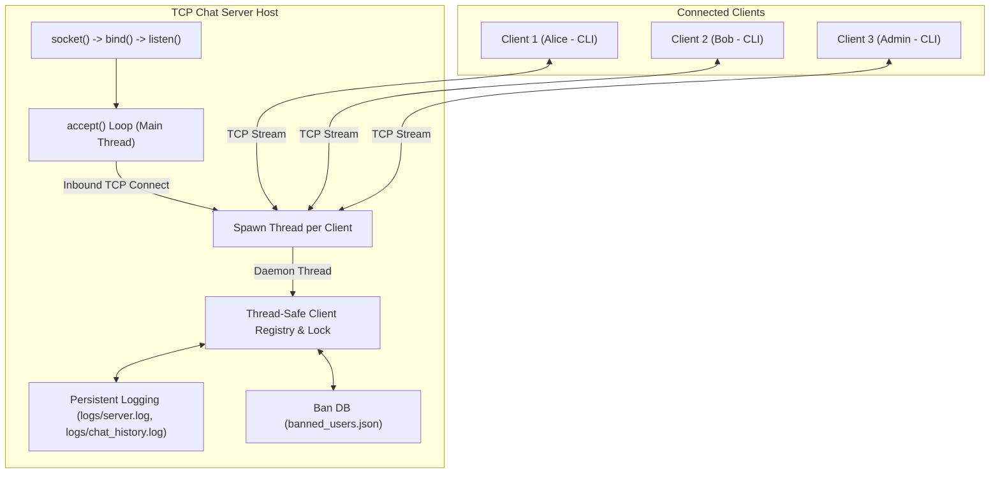

# COMPUTER NETWORKS LABORATORY (CNL) PROJECT REPORT

## PROJECT TITLE:
### Python-Based Multi-Client Client-Server Chat Application using TCP Sockets

---

## 1. ABSTRACT
In modern computer networks, inter-process communication (IPC) across distributed endpoints forms the backbone of digital interaction. This laboratory project presents the design, architectural analysis, and implementation of a multithreaded, real-time client-server chat system constructed using Python's socket interface over the Transmission Control Protocol (TCP/IP stack). 

The system provides reliable full-duplex message transmission, dynamic multi-client connection management, broadcast and unicast (direct messaging) routing, role-based administrative authority (kick and IP/nickname ban policies), and persistent event and communication logging. A streamlined command-line interface (CLI) approach provides an educational showcase of transport layer socket abstractions, concurrent thread synchronization, and application-layer protocol framing directly within the terminal.

---

## 2. PROBLEM STATEMENT & OBJECTIVES

### 2.1 Problem Statement
Designing an interactive real-time multi-user communication system requires addressing core networking challenges:
1. **Concurrency:** A single listening port must accept multiple simultaneous inbound connections without blocking on individual I/O reads.
2. **Reliability & Ordering:** Text messages must arrive intact, in order, and without packet degradation.
3. **Stream Boundary Preservation:** Because TCP is an unformatted continuous byte stream, boundaries between distinct transmissions must be preserved without packet clumping or truncation.
4. **State Management & Auditing:** The system must maintain real-time awareness of active participants, enforce security permissions, and log audit trails for post-session analysis.

### 2.2 Objectives
* To design a multithreaded TCP server utilizing `socket.AF_INET` and `socket.SOCK_STREAM`.
* To handle simultaneous connections via worker threads and thread-safe data synchronization (`threading.Lock`).
* To implement full-duplex client communication allowing concurrent sending and receiving.
* To provide broadcast distribution, unicast direct messaging (`/msg`), and administrative access (`/kick`, `/ban`, `/unban`).
* To record network events in `logs/server.log` and message exchanges in `logs/chat_history.log`.
* To deploy an interactive terminal CLI client frontend using standard libraries.

---

## 3. THEORETICAL BACKGROUND

### 3.1 The Transport Layer & TCP vs. UDP
In the OSI and TCP/IP protocol stacks, the Transport Layer (Layer 4) is responsible for host-to-host communication. Two primary protocols operate at this layer:

| Metric | TCP (Transmission Control Protocol) | UDP (User Datagram Protocol) |
|---|---|---|
| **Connection State** | Connection-Oriented (Virtual circuit established) | Connectionless |
| **Reliability** | Guaranteed delivery (Acknowledgments, Retransmissions) | Best-effort (Packets can be lost) |
| **Data Ordering** | Strict sequencing via sequence numbers | Out-of-order arrival possible |
| **Flow & Congestion Control**| Yes (Sliding window, AIMD algorithms) | No |
| **Protocol Overhead** | 20-60 byte header | 8 byte header |
| **Use Cases** | Chat, HTTP/HTTPS, SSH, File Transfer (FTP) | Video streaming, DNS, VoIP, Online Gaming |

**Design Selection:** TCP was chosen because chat communications demand 100% data integrity and in-order delivery.

### 3.2 TCP Three-Way Handshake
Before any client message can be transmitted, TCP establishes a synchronized virtual connection:
1. **SYN:** Client sends a `SYN` segment with an initial sequence number ($ISN_c$) to the server port.
2. **SYN-ACK:** Server acknowledges with an `ACK = ISN_c + 1` and provides its own sequence number ($ISN_s$).
3. **ACK:** Client responds with `ACK = ISN_s + 1`. The connection moves to the `ESTABLISHED` state.



### 3.3 The Berkeley Sockets Lifecycle
Sockets provide the standard API for network input/output:
* **Server Side:**
  1. `socket()`: Allocate socket descriptor (`AF_INET`, `SOCK_STREAM`).
  2. `setsockopt(SO_REUSEADDR)`: Prevent port binding lockouts in `TIME_WAIT`.
  3. `bind()`: Associate socket with an IP address and port number.
  4. `listen()`: Transition socket into passive listening mode with a backlog queue.
  5. `accept()`: Block until an incoming client connection arrives; returns a new dedicated socket descriptor for that client.
  6. `recv()` / `sendall()`: Read and write data over the client socket.
  7. `close()`: Terminate socket descriptor.
* **Client Side:**
  1. `socket()`: Allocate client socket descriptor.
  2. `connect()`: Perform TCP three-way handshake to remote host and port.
  3. `recv()` / `sendall()`: Transmit and receive stream data.
  4. `close()`: Send `FIN` packet to tear down virtual circuit.

---

## 4. SYSTEM ARCHITECTURE & DESIGN

### 4.1 Block Diagram


### 4.2 Application Layer Protocol Specification (Framing)
TCP treats data as a continuous stream of raw bytes. To eliminate message concatenation (framing collision), the application defines a delimited protocol using newline termination (`\n`):

* **Authentication Protocol:**
  * `Server -> Client`: `AUTH_REQUEST: Enter your nickname`
  * `Client -> Server`: `<nickname>\n`
  * `Server -> Client`: `AUTH_PASS_REQ: Enter Admin Password` (if `<nickname> == admin`)
  * `Client -> Server`: `<password>\n`
  * `Server -> Client`: `AUTH_OK: Welcome <nickname> ...\n` or `AUTH_ERROR: ...\n` / `AUTH_REJECT: ...\n`
* **Chat Commands Protocol:**
  * Broadcast: `<message_text>\n`
  * Unicast (PM): `/msg <recipient> <message_text>\n`
  * Online Users: `/users\n` or `/list\n`
  * Help: `/help\n`
  * Admin Kick: `/kick <user>\n`
  * Admin Ban: `/ban <user>\n`
  * Disconnect: `/quit\n` or `/exit\n`

---

## 5. IMPLEMENTATION DETAILS

### 5.1 Project Modules

| File | Purpose | Key Technical Elements |
|---|---|---|
| [server.py](file:///c:/Users/ombha/OneDrive/Desktop/Project/TCP%20Chat/server.py) | Multithreaded TCP Server | `socket`, `threading.Thread`, `threading.Lock`, broadcast algorithm, ban manager |
| [client.py](file:///c:/Users/ombha/OneDrive/Desktop/Project/TCP%20Chat/client.py) | Interactive CLI Client | Non-blocking dual-threaded I/O, masked password input via `getpass`, ANSI coloring |
| [config.py](file:///c:/Users/ombha/OneDrive/Desktop/Project/TCP%20Chat/config.py) | System Configuration | Host, port, buffer size (4096 bytes), credentials, file paths |
| [utils.py](file:///c:/Users/ombha/OneDrive/Desktop/Project/TCP%20Chat/utils.py) | Shared Utility Services | Formatted timestamps, unified logging setup, terminal ANSI styling |
| [test_chat.py](file:///c:/Users/ombha/OneDrive/Desktop/Project/TCP%20Chat/test_chat.py) | Automated Testing Suite | Subprocess orchestration, end-to-end socket testing, broadcast & unicast assertions |

### 5.2 Concurrency & Thread Synchronization
When multiple clients attempt to write to or read from the server simultaneously, race conditions can corrupt client listings or crash iterations. 

```python
with self.lock:
    for client_sock in list(self.clients.keys()):
        if client_sock != exclude_socket:
            client_sock.sendall((message + "\n").encode(config.ENCODING))
```
The server protects all mutations and iterations over `self.clients` and `self.nicknames` using Python's `threading.Lock()` context manager (`with self.lock:`).

---

## 6. EXPERIMENTAL TEST RESULTS & VERIFICATION

### 6.1 Automated Integration Testing
The test script [test_chat.py](file:///c:/Users/ombha/OneDrive/Desktop/Project/TCP%20Chat/test_chat.py) verifies seven distinct network conditions programmatically:

```
[TEST] 1. Launching Chat Server on port 5599
[TEST] 2. Connecting Client 1 ('Alice')...
[TEST] 3. Connecting Client 2 ('Bob')...
[TEST] 4. Testing Broadcast: Alice sends 'Hello world'...
  -> Passed: Bob received broadcast from Alice!
[TEST] 5. Testing Private Messaging (/msg)...
  -> Passed: Private message received by Alice!
[TEST] 6. Disconnecting Alice and Bob...
[TEST] 7. Verifying logs created...
  -> Passed: Chat logs verified on disk!

ALL AUTOMATED TESTS PASSED SUCCESSFULLY! (100% Success)
```

### 6.2 Server Log Output (`logs/server.log`)
```
[2026-10-06 17:58:39] [INFO] [SYSTEM] Server started listening on 127.0.0.1:5599
[2026-10-06 17:58:40] [INFO] [JOIN] 'Alice' connected from 127.0.0.1:59881 (Admin=False)
[2026-10-06 17:58:40] [INFO] [JOIN] 'Bob' connected from 127.0.0.1:59883 (Admin=False)
[2026-10-06 17:58:41] [INFO] [MSG] Alice: Hello world
[2026-10-06 17:58:41] [INFO] [PM] Bob -> Alice: SecretMessage123
[2026-10-06 17:58:42] [INFO] [LEAVE] 'Alice' disconnected.
[2026-10-06 17:58:42] [INFO] [LEAVE] 'Bob' disconnected.
```

### 6.3 Chat Transcript Log (`logs/chat_history.log`)
```
[2026-10-06 17:58:40] [INFO] [SERVER] >>> 'Alice' joined the chat room.
[2026-10-06 17:58:40] [INFO] [SERVER] >>> 'Bob' joined the chat room.
[2026-10-06 17:58:41] [INFO] [17:58:41] Alice: Hello world
[2026-10-06 17:58:41] [INFO] [17:58:41] (Private Bob -> Alice): SecretMessage123
[2026-10-06 17:58:42] [INFO] [SERVER] <<< 'Alice' has left the chat.
[2026-10-06 17:58:42] [INFO] [SERVER] <<< 'Bob' has left the chat.
```

---

## 7. CONCLUSION & FUTURE SCOPE

### 7.1 Conclusion
The Python-based multi-client TCP chat application fulfills all foundational principles of Computer Networks Laboratory curricula. It successfully implements the transport layer socket programming abstraction, resolves concurrency through multithreading and mutual exclusion, preserves message boundaries through newline framing, provides broadcast and unicast communication channels, enforces role-based administrative policies, and maintains persistent audit logging.

### 7.2 Future Scope
* **End-to-End Encryption (E2EE):** Integration of Diffie-Hellman Key Exchange and AES-GCM encryption for payload security.
* **File Transfer Support:** Adding out-of-band binary file chunk streaming over dedicated sub-sockets.
* **Database Integration:** Upgrading JSON flat-file storage to an SQLite/PostgreSQL relational database for historical search and user profile storage.

---

## 8. REFERENCES
1. Kurose, J. F., & Ross, K. W. *Computer Networking: A Top-Down Approach* (8th Edition), Pearson.
2. Stevens, W. R., Fenner, B., & Rudoff, A. M. *UNIX Network Programming: The Sockets Networking API* (Vol. 1), Addison-Wesley.
3. Python Official Documentation: `socket` — Low-level networking interface (`https://docs.python.org/3/library/socket.html`).
4. Real Python: *Socket Programming in Python (Guide)* (`https://realpython.com/python-sockets/`).
