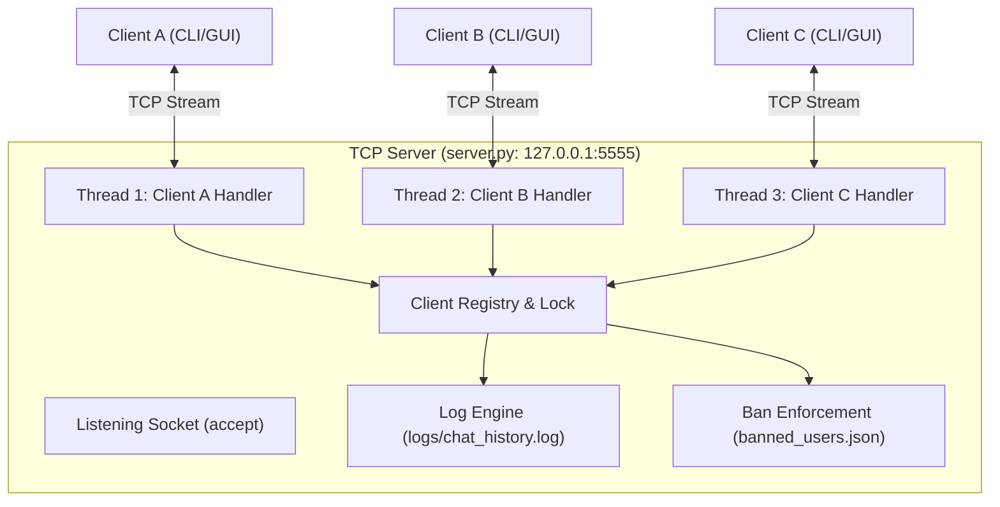

# 📡 Python-Based Multi-Client TCP Chat Application
### Computer Networks Lab (CNL) Project


-brightgreen.svg)


---

## 📌 Project Overview

This project is a high-performance, multithreaded **Client-Server Chat Application** built using **Python Socket Programming** and the **TCP (Transmission Control Protocol)** stack. 

It satisfies all standard curriculum requirements for the **Computer Networks Laboratory (CNL)**:
- **Multiple Client Connections:** Concurrent client handling using multithreading (`threading`).
- **Full-Duplex Communication:** Independent sending and receiving threads preventing stream blocking.
- **Message Broadcasting & Unicast:** Supports broadcasting messages to all active participants and direct private messaging (`/msg`).
- **Server Response & Status Notifications:** Connection acknowledgments, join/leave notices, error notifications.
- **Administrative Controls:** Dedicated admin login, user kicking (`/kick`), persistent IP/nickname banning (`/ban`), and unbanning (`/unban`).
- **Persistent Chat & Server Logs:** Dual-level logging recording network events in `logs/server.log` and message histories in `logs/chat_history.log`.
- **Dual Client Interfaces:** Both a modern CLI client (`client.py`) and a dark-mode Desktop GUI client (`gui_client.py` using standard Tkinter).

---

## 🏗️ System Architecture



---

## ⚙️ Key Features

| Category | Features |
|---|---|
| **Networking** | TCP protocol (`AF_INET`, `SOCK_STREAM`), `SO_REUSEADDR`, stream framing, connection handshake |
| **Concurrency** | Multithreaded server (daemon client threads), thread-safe shared state using `threading.Lock` |
| **Messaging** | Public broadcast, Direct Private Messaging (`/msg <user> <text>`), online list (`/users`) |
| **Administration** | Admin credentials check, `/kick <user>`, persistent `/ban <user>`, `/unban <user>`, `/banned` list |
| **Logging** | ISO timestamps, automated event logging to file (`server.log`, `chat_history.log`), server terminal color output |
| **User Interfaces** | 1. Terminal CLI (`client.py`) with colored tags<br>2. Tkinter Desktop GUI (`gui_client.py`) with dark theme |

---

## 📁 Repository Structure

```
TCP Chat/
├── server.py              # Multithreaded TCP Server
├── client.py              # Interactive Command-Line Interface (CLI) Client
├── gui_client.py          # Modern Dark-Themed Desktop GUI Client (Tkinter)
├── config.py              # Central network configuration & parameters
├── utils.py               # Protocol helpers, timestamps, logging setup
├── test_chat.py           # Automated end-to-end integration test
├── banned_users.json      # Persistent storage for banned nicknames and IPs
├── requirements.txt       # Dependencies info (100% Python Standard Library)
├── run_server.bat         # 1-Click launcher for Server (Windows)
├── run_client.bat         # 1-Click launcher for CLI Client (Windows)
├── run_gui_client.bat     # 1-Click launcher for GUI Client (Windows)
├── README.md              # Project documentation and Viva Voce preparation
├── PROJECT_REPORT.md      # Formal academic CNL laboratory report
└── logs/
    ├── server.log         # Network events, binds, connections, disconnections
    └── chat_history.log   # Chronological message transcripts with timestamps
```

---

## 🚀 How to Run the Project

### Prerequisites
- Python 3.8 or higher installed on your system.
- Zero external package installation is required (uses Python built-in modules).

### Option 1: 1-Click Windows Launchers
1. Double-click `run_server.bat` to launch the server in a terminal.
2. Double-click `run_client.bat` or `run_gui_client.bat` to open clients.
3. Open multiple clients to test group chat, private messaging, and admin controls!

### Option 2: Terminal Execution

**Step 1: Start the Chat Server**
```bash
python server.py
```
*(Optionally specify host and port: `python server.py 127.0.0.1 5555`)*

**Step 2: Start Client 1 (CLI)**
```bash
python client.py
```
Enter your desired nickname (e.g., `Alice`).

**Step 3: Start Client 2 (GUI)**
```bash
python gui_client.py
```
Enter the server IP (`127.0.0.1`), Port (`5555`), and a nickname (e.g., `Bob`), then click **Connect**.

**Step 4: Connect as Administrator (Optional)**
- Nickname: `admin`
- Password: `admin123` (configured in `config.py`)

---

## 💬 Command Reference

| Command | Permission | Description | Example |
|---|---|---|---|
| `/help` | All Users | Display available command help | `/help` |
| `/users` or `/list` | All Users | List all currently connected users | `/users` |
| `/msg <user> <message>` | All Users | Send a private direct message | `/msg Alice Hey there!` |
| `/quit` or `/exit` | All Users | Safely disconnect from the server | `/quit` |
| `/kick <user>` | Admin Only | Disconnect a specific user from the room | `/kick Bob` |
| `/ban <user>` | Admin Only | Permanently ban user nickname & IP | `/ban TrollUser` |
| `/unban <user>` | Admin Only | Remove user from the ban list | `/unban TrollUser` |
| `/banned` | Admin Only | View banned nicknames and IP list | `/banned` |
| `/clearlogs` | Admin Only | Clear server chat history log | `/clearlogs` |

---

## 🧪 Automated Testing

An automated end-to-end integration test is provided in `test_chat.py`. It spins up a test server, connects multiple clients, validates the handshake, tests broadcast messaging, private messaging, graceful disconnects, and verifies persistent log entries.

Run the test suite:
```bash
python test_chat.py
```

Expected Output:
```
[TEST] 1. Launching Chat Server on port 5599
[TEST] 2. Connecting Client 1 ('Alice')...
[TEST] 3. Connecting Client 2 ('Bob')...
[TEST] 4. Testing Broadcast: Alice sends 'Hello world'...
  -> Passed: Bob received broadcast from Alice!
[TEST] 5. Testing Private Messaging (/msg)...
  -> Passed: Private message received by Alice!
[TEST] 6. Disconnecting Alice and Bob...
[TEST] 7. Verifying logs created...
  -> Passed: Chat logs verified on disk!

ALL AUTOMATED TESTS PASSED SUCCESSFULLY! (100% Success)
```

---

## 🎓 Viva Voce & Interview Questions (CNL Preparation)

**Q1: Why did you choose TCP instead of UDP for this chat application?**  
> *Answer:* TCP (Transmission Control Protocol) is connection-oriented and guarantees reliable, ordered, and error-checked delivery of packets through sequence numbers and acknowledgments. In a chat application, missing or out-of-order messages degrade communication. UDP is connectionless and lossy, which is unsuitable for text chat.

**Q2: What is the role of `socket.setsockopt(socket.SOL_SOCKET, socket.SO_REUSEADDR, 1)`?**  
> *Answer:* When a TCP server shuts down, the port enters the `TIME_WAIT` state for standard TCP teardown. Setting `SO_REUSEADDR` allows the server to immediately rebind and restart on the same port without waiting for the `TIME_WAIT` interval to expire.

**Q3: How does the server handle multiple clients at the same time?**  
> *Answer:* The server main thread listens for incoming connections using `server_socket.accept()`. Once a connection arrives, it spawns a separate worker thread (`threading.Thread`) for that client. Each client thread independently executes `recv()` in a loop without blocking the main listening socket or other clients.

**Q4: Why is `threading.Lock` needed in `server.py`?**  
> *Answer:* The client dictionary (`self.clients`) and nickname mapping are shared resources accessed concurrently by multiple client threads (e.g. during connect, disconnect, broadcasting, and private messaging). Using a mutex lock prevents race conditions and dictionary mutation errors during iteration.

**Q5: What is stream framing and why is it important in TCP sockets?**  
> *Answer:* TCP is a byte-stream protocol, not a message-based protocol. It does not preserve packet boundaries (messages may be fragmented or coalesced). We implemented newline delimiter (`\n`) framing so the receiver can reliably separate individual chat messages from the byte stream.
